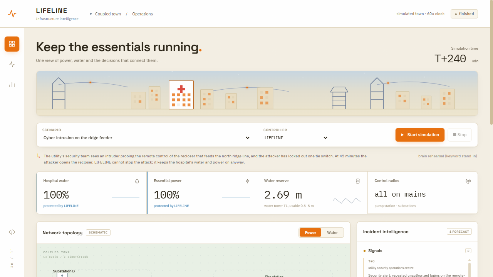
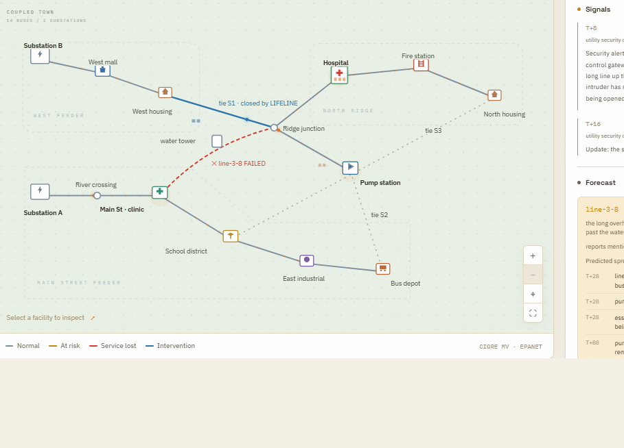
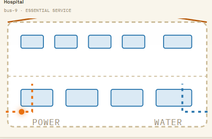
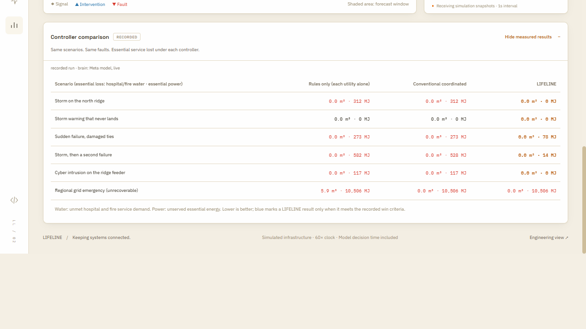
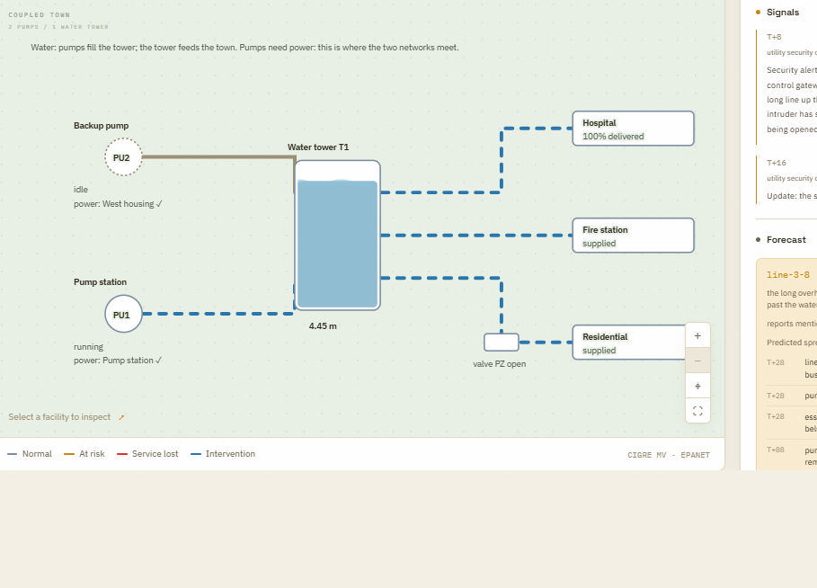

# LIFELINE

**LIFELINE detects emerging threats, predicts how failures could spread, and coordinates interventions that preserve essential services across power, water, communications, and other infrastructure.**

<p align="center">
  <a href="docs/demo/lifeline-promo.mp4">
    
  </a>
</p>

<p align="center">
  <video src="docs/demo/lifeline-promo.mp4" controls width="100%" poster="docs/demo/screenshots/network-map.png">
    Your viewer can't play inline video — <a href="docs/demo/lifeline-promo.mp4">download/open the video directly</a>.
  </video>
</p>

<p align="center"><sub>2:40 — cinematic cold open, then a continuous, real screen capture of an actual simulated run (not staged), with a music bed. See <a href="docs/demo/lifeline-promo.md">production notes</a>.</sub></p>

## LIFELINE v2: think slow, act fast

```
 warning signs (security alerts, crew radio notes,     ┌──────── SLOW · the brain (Meta model) ────────┐
 weather bulletins, in plain language) ──────────────► │ reads the reports with the town map and live  │
 live telemetry ─────────────────────────────────────► │ telemetry → threats: asset, time window,      │
                                                        │ confidence, cited report                      │
                                                        └──────────────────────┬───────────────────────┘
                                                                               ▼
                           PREDICT · the coupled simulator plays each threat forward: what fails, when
                           VERIFY  · an act-now step is taken only if it helps when the threat comes
                                     and does no harm when it does not
                                                                               ▼
                           FAST · reflexes fire the pre-planned tie or generator within one step of buses
                                  going dark; the safety rules and the mitigation planner keep running
```

The model never touches a switch directly. It turns what people write into specific threats, and the physics checks and fast automation do the rest. The design follows from our own negative result: putting the model *inside* the live control loop added delay and changed no decision ([P18](docs/trials/lifeline-infrastructure-comparison-run-0.md)). So v2 does its thinking before the failure.

**Measured on the simulated town** (recorded run, live Meta brain; same faults, same clock and executor for every controller: [`docs/results/lifeline-v2-run-0.json`](docs/results/lifeline-v2-run-0.json)). Each cell is essential power left unserved; hospital and fire water loss was 0 unless shown.

| Scenario | Rules only | Conventional coordinated | **LIFELINE** |
| --- | --- | --- | --- |
| Storm on the north ridge (wind bulletin, then a crew sighting) | 312 MJ | 312 MJ | **0 MJ**: flagged the ridge line from the bulletin at T+5; tie closed at T+24, 31 min before the line failed |
| Storm warning that never lands | 0 | 0 | **0**: pre-closed a tie the simulation showed harmless; the all-clear lowered confidence (0.70 → 0.65); no harm |
| Sudden failure, two tie switches jammed (no warning) | 273 MJ | 273 MJ | **78 MJ**: reflex at T+30; jammed tie refused; second tie restored power at T+32 |
| Storm, then a flood takes a second line | 582 MJ | 528 MJ | **14 MJ** |
| Cyber intrusion on the ridge feeder (security team's alert) | 117 MJ | 117 MJ | **0 MJ**: read the alert at T+8; the attacker's tie lockout at T+15 cancelled the pending step; re-planned, tie closed at T+42, 3 min before the attack |
| Regional grid emergency (nothing can restore supply) | 10,506 MJ + 5.9 m³ water | 10,506 MJ | 10,506 MJ: generator pre-dispatched at T+18; **no better than conventional coordination** here |

These are six scenarios on one small simulated town, not a statistical study. In the cyber scenario LIFELINE reads the security team's alert; it does not detect intrusions.

**Run it** (after the town environment below is built):

```sh
npm start                                   # loads .env (MODEL_API_KEY) → http://127.0.0.1:3210/lifeline/ops
node --env-file-if-exists=.env scripts/lifeline-v2-run.mjs --out artifacts/lifeline/v2/my-run   # all storylines × 3 controllers
node scripts/lifeline-v2-run.mjs --brain stub --out artifacts/lifeline/v2/offline               # no model: keyword stand-in
```

The operations view (`/lifeline/ops`) follows control-room display practice: a neutral map where color marks only lost (red), threatened (amber) or changed-by-LIFELINE (blue); detect → predict → coordinate panels; a power/water toggle; a timeline; and the recorded comparison. Pitch script: [docs/pitch/lifeline-pitch.md](docs/pitch/lifeline-pitch.md). Promo video: [docs/demo/lifeline-promo.mp4](docs/demo/lifeline-promo.mp4) (2:40 — [notes](docs/demo/lifeline-promo.md)).

<table>
<tr>
<td width="50%">

<p align="center"><sub>LIFELINE closed the back-feed tie 3 minutes before the attacker struck — the failed line (red) never touches the hospital, because the tie (blue) already rerouted around it.</sub></p>
</td>
<td width="50%">

<p align="center"><sub>Click any facility for a cutaway of its power and water feeds — this one's still live on both.</sub></p>
</td>
</tr>
<tr>
<td width="50%">

<p align="center"><sub>Same faults, same town, three controllers — every number here is a measured result, not a projection.</sub></p>
</td>
<td width="50%">

<p align="center"><sub>The same brain and the same physics check, now on the water network — infrastructure plugs in the same way each time.</sub></p>
</td>
</tr>
</table>

## Platform underneath

- An emergency-communications prototype on a real packet network, with a Meta-assisted investigator.
- Qualified power (pandapower) and water (EPANET 2.2 via WNTR) plants, each with conventional controls and scored forecasts.
- A coupled power–water–communications town joined only by declared dependency edges, with a resource-aware joint planner, a strong conventional comparator, replayable run bundles and an engineering view (`/lifeline/town`).

Gates Q1–Q3 of the [full living program](docs/superpowers/plans/2026-10-31-lifeline-program.md) are met. The frozen held-out study (P17–P18) is complete and **negative** for the model-in-the-loop design: B2 not supported, B5 contradicted.

Facilities are synthetic: real Linux packets in a Mininet/Open vSwitch emulator, a CIGRE benchmark feeder and a small water network, with no connection to any real dispatch, clinic, utility or radio service.

## What we measured

| Claim | Status | Evidence |
| --- | --- | --- |
| Real packet network with independent receipt scoring | Supported | [Packet run 0](docs/trials/lifeline-packet-run-0.md): fixed-policy cascade 63.1% on time; [metrics](docs/trials/lifeline-metrics-run-0.md) |
| Strong conventional baseline | Supported | [Baseline run 0](docs/trials/lifeline-baseline-run-0.md): adaptive 100% on the development cascade; no-fault, partition and stale-telemetry controls pass |
| Meta model takes part in real decisions with measured consequences | Supported (prototype) | [Meta run 0](docs/trials/lifeline-meta-run-0.md): typed hypotheses citing observations, discriminating probes (60% vs 0% loss on a silent lossy link), guarded interventions |
| Failure handling (invalid, stale, partial, provider failure) | Supported | [Guard](docs/trials/lifeline-guard-run-0.md), [execution](docs/trials/lifeline-execution-run-0.md), [recovery](docs/trials/lifeline-recovery-run-0.md) runs; provider interruption rehearsal |
| **AI improves essential delivery over the strong baseline** | **Not supported** | [Pilot run 0](docs/trials/lifeline-pilot-run-0.md): 48 runs (8 cases × 3 controllers × 2 repetitions), meta − adaptive **−1.35 pp** (6 ties at reported precision, p5 −7.24, p6 −0.88) |
| Repaired controller removes that regression | Supported; **AI value not shown** | [Communications v2](docs/trials/lifeline-communications-v2-run-0.md): meta − adaptive −0.003 pp (regression removed); meta − model-disabled interval −0.003 to +0.015 pp |
| Power and water plants, controls and forecasts qualified | Supported (development) | [P06](docs/trials/lifeline-infra-p06-run-0.md)–[P10](docs/trials/lifeline-infra-p10-run-0.md): analytic and reference checks, restart/fork, local and predictive baselines, forecasts scored for lead time and calibration (power overload timing is **not** calibrated) |
| Cascades follow physical equations across domains | Supported (development town) | [P11](docs/trials/lifeline-infra-p11-run-0.md): a feeder trip stops a pump; the hospital loses water 69 min later; removing the edge removes the loss |
| Coordination preserves essential service | Supported on development cases, with cost | [P13](docs/trials/lifeline-infra-p13-run-0.md), [release](docs/releases/lifeline-town-release.md): the joint comparator removes essential water loss in two cases at a non-essential cost |
| **Meta improves the coupled town over the joint comparator** | **Not supported** | [P14](docs/trials/lifeline-infra-p14-run-0.md): one live model decision changed an action; against the revised comparator the model added latency, not value |
| **Meta in the loop beats both comparators on a frozen held-out suite (B2)** | **Not supported** | [P18](docs/trials/lifeline-infrastructure-comparison-run-0.md): 16 groups; contradicted vs independent, inconclusive vs coordinated; the model changed 0 of 17 decisions |
| LIFELINE v2 (brain reads warnings, verified act-now, reflexes) keeps essential service in the demo storylines | Measured on 6 storylines; better in 4, equal in 2; not a statistical study | [Run summary](docs/results/lifeline-v2-run-0.json): 0 / 0 / 78 / 14 / 0 / 10,506 MJ vs 312 / 0 / 273 / 528 / 117 / 10,506 MJ for conventional coordination |

**Why the AI did not win.** Live Muse Spark calls took 14–18 s, and 21% of pilot calls timed out. The deterministic layer handles failover in about a second. In this version the model replaced a fast conventional rule for unexplained degradation, so it recovered later. The model's diagnoses were often right ("r4→r3 reduced to ~3 Mbps"), but they came too late to beat the rule. The next protocol revision keeps the rule active and runs the model in parallel. That is a design hypothesis, not a result.

## Architecture of the communications prototype

```
judge / benchmark faults ──► isolated Mininet network ◄── bounded executor ◄── guard + forecast ◄── typed proposals
                                   │                                                  ▲
                                   ▼                                                  │
                    telemetry (counters, age; no fault truth) ──► deterministic controller + Meta investigator
                                   │
                                   ▼
               sender/receiver records ──► independent receipt scorer ──► hash-chained ledger ──► replay verifier
```

- **Worker** (`runtime/mininet/`): privileged Python process in the Linux VM; allowlisted commands; only the orchestrator role may build scenarios or inject faults.
- **Supervisor** (`scripts/lifeline-run.mjs`, `src/lifeline/`): typed worker transport, telemetry admission and audit, evidence-linked capacity beliefs, forecasts, the admission guard, the executor (versioned routes, read-back, reconciliation, rollback), the run ledger.
- **Controllers** (`src/lifeline/controllers/`): `priority` (failover and shedding), `adaptive` (measured capacity, probes, exhaustive route × rate search, hysteresis), `meta` (adaptive layer plus the Muse Spark investigator).
- **Interface** (`/lifeline`): network map, receipt-scored service strips, investigation timeline labeled META or DETERMINISTIC, replay scrubber, judge fault controls, pilot comparison, evidence export.

## Run it

**Storage rule:** all project files, environments, caches, VM disks and outputs stay on `/Volumes/PortableSSD/Meta_Hackathon` ([rule](docs/superpowers/plans/2026-10-31-lifeline-program.md#0-ssd-workspace-and-storage-rule)).

Host (macOS, Apple silicon) prerequisites: Node.js ≥ 22, Lima 2.x, the SSD mounted. Verified on November 1, 2026 by building a second guest from scratch ([clean-room run](docs/trials/lifeline-infra-p00-run-0.md)): 180 s from `limactl start` to a provisioned guest, no manual corrections.

```sh
cd /Volumes/PortableSSD/Meta_Hackathon
python3 scripts/lifeline-preflight.py --storage-only --vm-backing .work/vm --out .work/tmp/preflight.json   # refuses an absent or off-SSD layout

# 1. VM state lives in an APFS image on the SSD (ExFAT cannot hold the VM's sockets)
hdiutil create -size 60g -type SPARSEBUNDLE -fs APFS -volname LifelineVM .work/vm/lifeline-apfs.sparsebundle   # first time only
hdiutil attach -nobrowse .work/vm/lifeline-apfs.sparsebundle          # mounts /Volumes/LifelineVM
export LIMA_HOME=/Volumes/LifelineVM/lima

# 2. Guest image (once): Ubuntu 24.04 arm64 cloud image into .work/downloads, checked against Ubuntu's SHA256SUMS
#    https://cloud-images.ubuntu.com/releases/noble/release/ubuntu-24.04-server-cloudimg-arm64.img

# 3. Create and provision the guest. Packages are pinned in the definition: mininet 2.3.0-1.1,
#    openvswitch 3.3.9-0ubuntu0.24.04.1, iperf3, rsync, Node v24.14.1 (nodejs.org, checksum verified)
limactl start --tty=false --name=lifeline-clean runtime/vm/lifeline-cleanroom.yaml   # later: limactl start lifeline-clean

# 4. Copy the source into the guest's native filesystem; test; start the server there
limactl shell lifeline-clean -- bash -lc 'rsync -a --delete --exclude .work --exclude artifacts /mnt/lifeline-src/ /workspace/Meta_Hackathon/ && cd /workspace/Meta_Hackathon && node --test test/lifeline/*.test.mjs && PORT=3311 node --env-file-if-exists=.env server.mjs'
```

The original demo guest `lifeline` (`runtime/vm/lifeline-lima.yaml`, provisioned by hand on October 31) also works, with the same commands and guest name `lifeline`.

**Credentials are user-supplied inputs.** Create `.env` from `.env.example` and set `MODEL_API_KEY` yourself; it is git-ignored and is copied into the guest with the source. The key stays in the server process, and no artifact records it. Without it, the conventional controllers and replay work, and the Meta-assisted controller is refused as `provider_unavailable`.

Open **http://localhost:3311/lifeline** on the Mac (Lima forwards the port).

Demo: choose scenario `operator`, controller **LIFELINE (Meta-assisted)**, **Start live run**, then use **Judge fault** (cut r0-r3, then throttle r3-r4). Recorded runs replay from **Recorded run**. See the [demo script](docs/demo/lifeline-demo-script.md).

## Run the coupled town (host only; no VM needed)

```sh
cd /Volumes/PortableSSD/Meta_Hackathon
export UV_PYTHON_INSTALL_DIR=$PWD/.work/python UV_CACHE_DIR=$PWD/.work/cache/uv
uv python install 3.12 && uv venv --python 3.12 --managed-python .work/environments/town
VIRTUAL_ENV=$PWD/.work/environments/town uv pip install -r runtime/infra/requirements-town.lock
PORT=3311 node --env-file-if-exists=.env server.mjs        # open http://localhost:3311/lifeline/town
node scripts/lifeline-infra-run.mjs --case b-second-fault --controller hybrid --out artifacts/lifeline/infra/my-run
node scripts/lifeline-infra-replay.mjs --run artifacts/lifeline/infra/my-run --verify   # no provider; recomputes the score
```

The town runs at an accelerated, modeled 60× clock: one simulated minute per wall second, with decision time charged on that clock. Rebuilding the environment from the lockfile was verified on November 3, 2026 ([release](docs/releases/lifeline-town-release.md)). Demo: [town demo script](docs/demo/lifeline-town-demo.md).

## Verify

```sh
npm test                                                     # Node tests (communications, kernel, adapters, planner, controllers, town HTTP, replay)
.work/environments/town/bin/python -m unittest discover -s runtime/infra/tests -p "test_*.py"   # power, water, coupling, clock, baselines (Grid2Op tests skip here)
python3 -m unittest discover -s runtime/mininet/tests -p "test_*.py"
# inside the VM, as root, for real OVS integration:
sudo LIFELINE_INTEGRATION=1 python3 -m unittest discover -s runtime/mininet/tests -p test_integration.py
node scripts/lifeline-replay.mjs --run <run bundle> --verify   # ledger, scores from raw receipts, contract decisions, linkage
node --env-file-if-exists=.env scripts/lifeline-evaluate.mjs --protocol fixtures/lifeline/protocol-v1.json --suite pilot --backend mininet --out artifacts/lifeline/pilot-v1
```

## Project documents

- [Full living program](docs/superpowers/plans/2026-10-31-lifeline-program.md) · [Infrastructure design](docs/superpowers/specs/2026-11-01-lifeline-infrastructure-design.md) · [Breakthroughs and evaluation](docs/research/lifeline-infrastructure-evaluation.md) · [Run register](docs/trials/lifeline-run-register.md)
- Implementation plans: [foundation](docs/superpowers/plans/2026-11-01-lifeline-foundation.md), [power and water](docs/superpowers/plans/2026-11-01-lifeline-power-water.md), [coordination](docs/superpowers/plans/2026-11-01-lifeline-coordination.md), [research and deployment](docs/superpowers/plans/2026-11-01-lifeline-research-deployment.md).
- Communications V1: [archived program](docs/superpowers/plans/2026-10-31-lifeline-communications-v1-archive.md) · [design](docs/superpowers/specs/2026-10-31-lifeline-design.md) · [protocol](docs/research/lifeline-evaluation-protocol.md) · [prior work](docs/research/lifeline-prior-work-scan.md) · [release](docs/releases/lifeline-hackathon-release.md).

## Limits

Emulated packets on one topology, not radio links. One local operator; not a hosted service. Two repetitions per pilot case, so no uncertainty interval is claimed. Localizing silent loss by probing is established practice (007, NetBouncer), not a LIFELINE invention.

The town is a small development model:

- steady-state power flow and distribution hydraulics, with no transients, protection coordination or water quality;
- communications modeled, not packet-measured;
- one frozen held-out comparison (P18, 16 groups, negative for the model-in-the-loop design); the v2 storylines are demonstrations, not a held-out study.

No claim about lives saved, real emergency traffic, utility operation or field deployment.

## Legacy prototype

The earlier **Blackbox Apprentice** device-learning demo still runs at `http://127.0.0.1:3210/` (`npm start`, no VM needed). Its notes are in [docs/competition.md](docs/competition.md). Its results are separate and are not LIFELINE results.
