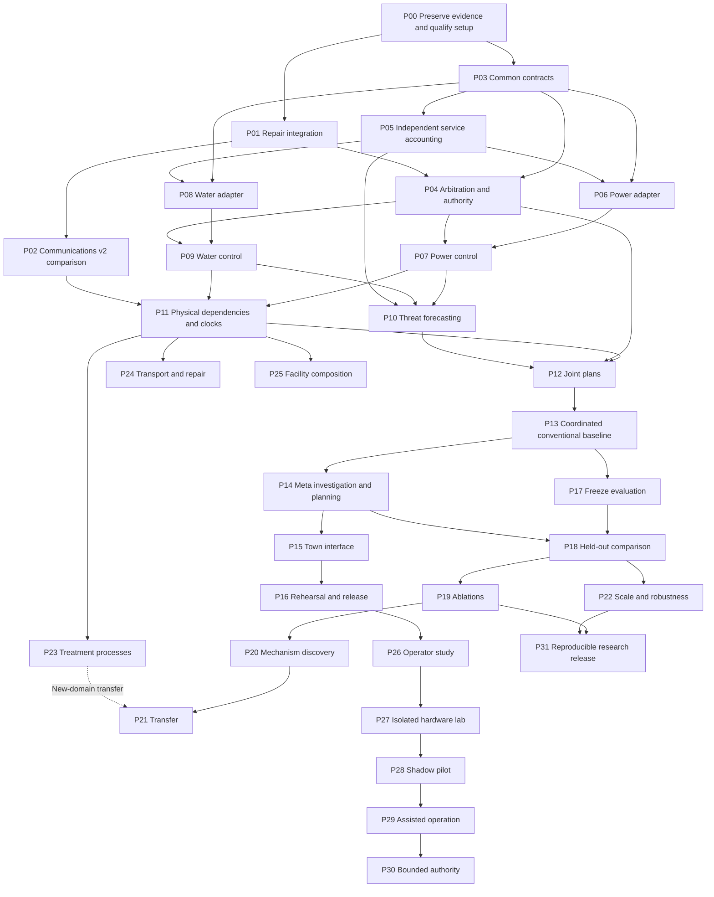

# LIFELINE Infrastructure Resilience — Living Program and TDD Plan

> **For agentic workers:** Use `superpowers:executing-plans` to implement one qualified increment at a time. Work inline unless delegation is separately authorized. Observe the intended RED, implement GREEN, run the named negative controls, and retain evidence before checking a task. Writing this plan does not qualify any planned capability.

**Goal:** LIFELINE detects emerging threats, predicts how failures could spread, and coordinates interventions that preserve essential services across power, water, communications, and other infrastructure.

**Architecture:** A shared resilience coordinator maintains an evidence-backed view of services, infrastructure dependencies, uncertainty, and available interventions. Domain adapters supply electrical, hydraulic, communications, and later process or transport models with their own controllers and validators. Fast local control continues while a Meta-assisted supervisor investigates, forecasts, compares plans, and proposes bounded actions; independent measurements establish what happened.

**Tech stack:** Existing Node.js ES modules, `node:test`, Python workers, Mininet/Open vSwitch, native browser JavaScript/SVG, and the Meta Model API. Planned additions are pandapower for the first coupled electrical model, WNTR/EPANET for distribution hydraulics, and a separate Grid2Op adapter for sequential grid-operation experiments. Versions and licenses are pinned during qualification, not assumed from current documentation.

**Revision:** Full-program revision, November 1, 2026. **Inspected code baseline:** local `lifeline` branch, `127ba02`. The filename remains stable for existing links. The [original communications program](2026-10-31-lifeline-communications-v1-archive.md) is retained as a historical snapshot; its task numbers and G0–G7 gates belong to V1.

**Read with:** [Infrastructure design](../specs/2026-11-01-lifeline-infrastructure-design.md), [breakthroughs and evaluation](../../research/lifeline-infrastructure-evaluation.md), [living run register](../../trials/lifeline-run-register.md).

## 0. SSD workspace and storage rule

All project-created files and project-controlled runtime data belong on the external SSD. The canonical repository is **`/Volumes/PortableSSD/Meta_Hackathon`**. A home-directory alias is a compatibility symlink only.

Before writing, installing, building, provisioning, or experimenting, verify that `/Volumes/PortableSSD` is an actual mounted volume and resolve the physical repository and output paths. If unavailable, stop with `storage_unavailable`; never create an internal-drive fallback or a directory pretending to be the missing mount. Read-only references elsewhere are permitted.

| Material | Required location relative to the SSD repository |
| --- | --- |
| Source, documentation, fixtures, Git | Repository |
| Environments and dependencies | `.work/environments/` or repository-local dependency directories |
| Package/model caches, downloaded datasets | `.work/cache/`, `.work/downloads/` |
| Temporary files, builds, logs | `.work/tmp/`, `.work/build/`, `.work/logs/` |
| Run bundles, captures, retained reports | `artifacts/lifeline/` |
| Worktrees | `.work/worktrees/` |
| VM disks, snapshots, container storage | `.work/vm/`, `.work/containers/` |

Configure tool defaults explicitly, including Python/package caches, simulator outputs, browser captures, and container volumes. Resolve output symlinks. Do not repurpose `HOME` or `CODEX_HOME`. Keep secrets out of evidence and version control.

The SSD is ExFAT. Linux permissions, sockets, and native runtime symlinks belong inside a native guest filesystem on an SSD-backed disk. Current VM state uses `.work/vm/lifeline-apfs.sparsebundle`, mounted at `/Volumes/LifelineVM`; Lima's guest has a native Linux filesystem. Guest RAM or SSD-backed temporary storage is allowed. Record host/guest mappings and free-space limits in every runtime preflight. Scratch exhaustion already caused withdrawn reruns; enforce cleanup and capacity checks.

The root [AGENTS.md](../../../AGENTS.md) carries this requirement into future sessions. A source checkout on the SSD alone does not establish that every tool writes there.

## 1. The whole project

LIFELINE is a system for preserving essential functions through developing, interacting failures. Its unit of success is a service that remains available or returns sooner: electricity for a critical facility, water delivered at usable pressure, messages delivered within their deadline, or a repair crew reaching a failed asset.

The shared decision cycle is:

**Observe → assess uncertainty → forecast consequences → compare interventions → check authority and constraints → act → verify → update the model.**

The scope includes four behaviors:

1. **Anticipate:** detect a threat while there is still time to change its consequences. Give an explicit forecast horizon, evidence, uncertainty, and a decision deadline.
2. **Prevent:** intervene before a predicted service loss or secondary failure, then evaluate whether the intervention prevented that outcome in a matched experiment.
3. **Mitigate:** preserve the most important feasible services while an incident continues. Account for the services and resources sacrificed.
4. **Recover:** sequence restoration, stabilize the recovered configuration, and avoid a second collapse.

Communications, power, and water are required domain milestones. Their interdependencies are a required integration milestone. Water treatment, transport/repair logistics, and facility systems extend the same program through separately qualified adapters. Breadth is delivered by qualified models and actions; changing labels on a network graph does not add a domain.

A single coordinator must operate across these domains without incident-specific code in its core. The adapters retain domain physics, equipment limitations, local protection, and authority. We do not require a language model to solve power flow or replace a pump controller.

## 2. What exists, what failed, and what remains unbuilt

| Area | Observed state at `127ba02` | Implication |
| --- | --- | --- |
| Communications runtime | Actual Linux packets, receiver-based scoring, guarded route/rate/probe actions, event ledger and replay | Reusable engineering foundation; one emulated network domain |
| Conventional control | Priority and adaptive controllers implemented | Preserve their full behavior while adding AI |
| Meta integration | Live diagnoses, probes, and interventions; substantial latency | Model participation is established; added service benefit is not |
| Frozen V1 pilot | 8 cases × 3 controllers × 2 repetitions = 48 retained first attempts | Exploratory comparison, not 48 independent scenarios |
| AI outcome | −1.35 percentage points vs adaptive over six recoverable failure cases; p5 −7.24 and p6 −0.88; other cases tied at reported precision | No AI improvement claim; priority also beat adaptive on some cases |
| Provider timing | 39 calls, 8 timeouts; investigation calls roughly 14–18 seconds | Slow reasoning must not suppress fast recovery |
| Release | UI and three rehearsals retained; narrated submission and clean-machine setup incomplete | Existing demo remains a usable release track |
| Shared infrastructure kernel | Planned | Current contracts and forecasts are network-specific |
| Power, water, coupled infrastructure | Planned; no results | These are central next phases |
| Generalization, new mechanism discovery, operational benefit | Unproven | Require new protocols, comparators, and evidence |

Evidence: [pilot](../../trials/lifeline-pilot-run-0.md), [release rehearsal](../../trials/lifeline-release-run-0.md), [release note](../../releases/lifeline-hackathon-release.md). The reported 240 Node tests, Python checks, and replay belong to that release record; this documentation revision does not rerun them.

V1 disables the adaptive controller's unexplained-degradation rule while the model is healthy. Its asynchronous failure path also uses the request snapshot's time, and the provider's configured decision deadline is not enforced across the investigation. P01 must test and repair these behaviors. Their individual contributions to the pilot loss have not been experimentally separated.

The six recoverable cases already average about 99.27% for adaptive, leaving about 0.73 percentage points of possible absolute improvement. Requiring a five-point improvement on that population would be impossible. New evaluations must include meaningful tradeoffs without artificially weakening the baseline.

The frozen V1 protocol and original artifacts remain unchanged. The replay reclassification, three restored valid runs, and nine withdrawn reruns remain disclosed. A new controller gets a new protocol identity and fresh evaluation cases.

## 3. What would count as a breakthrough

These are **targets, all currently unproven**, not labels for completed features.

| ID | Target | Decisive demonstration |
| --- | --- | --- |
| B1 | Anticipatory service preservation | A forecast arrives before loss; a feasible intervention reduces subsequent service deficit against a strong predictive comparator |
| B2 | Useful coordination across infrastructure | A joint plan preserves more essential service than both independent domain controllers and a coordinated conventional optimizer |
| B3 | Adaptation to an unfamiliar failure mechanism | Evidence-driven model revision improves decisions on an unseen mechanism family beyond fixed-model and established adaptive alternatives |
| B4 | Transfer of useful reasoning across domains | A frozen core handles held-out layouts/dependencies or a new admitted adapter with less incident-specific development and no harmful transfer |
| B5 | Reliable operation under incomplete information | Benefits persist with missing telemetry, delayed commands, provider outages, wrong hypotheses, and realistic action costs |
| B6 | Practical operator benefit | Operators make better or faster decisions in controlled tasks, followed by qualified shadow or field evidence |

The highest-impact result combines B1, B2, and B5: **the system sees a cascade developing, chooses an intervention that local controllers would miss, and preserves critical services under a second unfamiliar disruption.** B3 and B4 test whether this becomes a reusable capability beyond a prepared town.

The [evaluation plan](../../research/lifeline-infrastructure-evaluation.md) specifies comparators, measurements, numerical qualification targets, falsifiers, and claim boundaries for every B ID. Breadth can qualify even if AI adds no benefit. A positive AI result must survive matched information, action sets, budgets, and elapsed time.

## 4. The flagship demonstration

A small simulated town contains an electrical feeder, water source/pumps/storage/distribution, a communications network, and synthetic critical facilities. Each facility has declared service requirements and finite reserves.

A judge disables a permitted electrical asset. LIFELINE estimates which services are at risk, including delayed consequences such as water storage depletion or communications backup exhaustion. It compares options: electrical reconfiguration or demand shifts, a permitted pump schedule using stored water, and communications routing or traffic priorities. Domain solvers evaluate candidates and constraints. The operator sees which plan was chosen, why alternatives were rejected, and what remains uncertain.

A second judge-selected failure changes the situation: a pump becomes unavailable, a communication path fails, or a key observation becomes stale. LIFELINE replans against the changed state. The display shows actual power delivery, water service, and message receipts, alongside a matched conventional run.

The memorable moment should be a measurable avoided cascade: an action in one domain preserves a service in another, with a visible cost and a verified causal path. The demonstration must also handle an unrecoverable case honestly. An infeasible incident should produce a bounded mitigation plan and an explicit deficit.

The first town uses electrical and hydraulic simulation plus qualified communications emulation/modeling. A compressed replay must show both simulated time and playback speed. Live model waiting time is charged in the experiment; the world never pauses invisibly to let the AI catch up.

## 5. Program map and execution order

P IDs below belong to this revision. Legacy Tasks 1–19 remain in the archive.

| Phase | Tasks | Required output | Exit gate |
| --- | --- | --- | --- |
| Foundation | P00–P05 | Preserved V1, reproducible setup, repaired parallel control, common contracts and accounting | Q1 |
| Power and water | P06–P10 | Independently qualified power and water adapters, controllers, measurable threats | Q2 |
| Coordinated resilience | P11–P16 | Coupled town, joint conventional/Meta planning, causal demo and release | Q3 |
| Research | P17–P22 | Frozen benchmark, matched comparisons, ablations, mechanism/transfer/scale studies | Q4 |
| Broader infrastructure | P23–P25 | Treatment process, repair logistics/transport, facility service composition | Q5 per adapter |
| Operational progression | P26–P30 | Operator study, isolated lab, shadow mode, assisted operation, bounded authority | Q6–Q8 |
| Reproducible release | P31 | Rebuildable evidence, scoped claims, documentation and maintenance | Q9 |

Detailed TDD plans:

- [Foundation, P00–P05](2026-11-01-lifeline-foundation.md)
- [Power and water, P06–P10](2026-11-01-lifeline-power-water.md)
- [Coordination and demonstration, P11–P16](2026-11-01-lifeline-coordination.md)
- [Research, breadth, and deployment, P17–P31](2026-11-01-lifeline-research-deployment.md)

Dependency graph:

Power and water do not wait for a communications AI victory. They depend on sound shared contracts and independently credible domain models. Research novelty and live deployment also have separate gates; a novel paper is not a prerequisite for a useful operator tool, and a paper does not authorize actuation.

## 6. Qualification gates and task state

All new P tasks start **planned and unchecked**. Existing V1 accomplishments remain qualified only in their recorded scope.

| Gate | Evidence required | Claim allowed |
| --- | --- | --- |
| Q1 | P00–P05; clean setup, no suppressed baseline behavior, versioned common lifecycle and independent scoring | Reusable implementation foundation |
| Q2 | P06–P10; separate electrical/hydraulic controls and forecasts checked against references | Working power and water simulation adapters |
| Q3 | P11–P16; coupled causal tests, strong coordinator baseline, live or labeled replay demo | Working coupled infrastructure prototype |
| Q4 | P17–P22 studies, each with its own outcome | Only the B claims whose prespecified tests pass |
| Q5 | P23, P24, or P25 separately qualified | Additional named domain or service composition |
| Q6 | P26–P27 operator/lab evidence | Observed usability and isolated-lab behavior |
| Q7 | P28–P29 site-specific evidence | Shadow or assisted operation at the named site |
| Q8 | P30 scoped authority and operational acceptance | Bounded actuation within that qualification envelope |
| Q9 | P31 independent rebuild and complete evidence | Reproducible scoped release |

An investigation can finish with a negative result. Record `completed-negative` for its study, while the associated improvement claim stays unqualified. Use `planned`, `active`, `blocked`, `qualified`, `completed-negative`, and `superseded` explicitly; do not use one checked box for both experiment completion and success.

## 7. Calendar, resources, and release tracks

The public event page lists November 4, 2026 at 9 PM Eastern. This revision is written November 1. It is a full project plan, not a promise to finish every phase before that deadline. [Organizer event page](https://cerebralvalley.ai/e/meta-ai-developer-hackathon).

| Horizon | Delivery objective | Planning assumption |
| --- | --- | --- |
| Remaining hackathon window | Finish fresh setup; repair and compare if evidence can be retained; package the existing result honestly | One active engineer; portal/narration/publishing remain owner tasks |
| First 1–2 engineering weeks | P00–P10, including power and water prototypes and model qualification | Estimates subject to stepping/checkpoint feasibility; domain review available |
| Following 2–6 weeks | P11–P16 coupled town with strong conventional comparison | A qualified joint simulation is the breadth milestone |
| Following 1–3 months | P17–P22 controlled research and scaling | More scenario families, compute, and expert review than the pilot |
| Following 3–6 months | P23–P27 broader adapters and isolated operator/lab studies | Appropriate process models, equipment, and collaborators |
| Longer-term | P28–P31 named partner pilots and maintained releases | Site access, domain qualification and operational acceptance determine timing |

These are sequencing estimates, not commitments or evidence. If work slips, update dates while preserving required breadth and gates.

For each run batch, estimate solver time, model calls/tokens, retained disk use, and cost before starting. Use the configured account's actual remaining budget; do not assume unused event credits. A smaller prespecified study can be valid; stopping favorable runs early or deleting failed attempts cannot.

Roles are responsibilities, not an assumption that a team exists: coordinator/runtime; electrical modeling; hydraulic/process modeling; measurement/statistics; interface/demo; operator/domain review. One person may own several roles, but independent measurement must remain a separate code path.

## 8. Hackathon evidence

The retained release maps the organizer rubric to Impact 30%, Meta tooling 25%, Demo 25%, and Technical Depth 20%. The [V1 evaluation](../../research/lifeline-evaluation-protocol.md#11-hackathon-rubric-to-evidence) records the source; recheck accepted-portal terms before submission. The public waiver was not retrievable during this rewrite. Novelty is not a separate numerical rubric item.

| Criterion | Evidence the full program should produce |
| --- | --- |
| Impact | Measured essential service preserved, duration and distribution of outages, actual costs and operational use |
| Meta tooling | Model-generated hypotheses or plans that change a probe/action, with latency, failures, and model-removal comparison |
| Demo | A clear developing threat, a visible intervention, a second unexpected failure, measured outcomes, explicit live/replay state |
| Technical depth | Real domain engines, coupled dynamics, constraints, independent scoring, replay, baselines, and qualification tests |

A roadmap animation cannot be submitted as a working coupled system. If Q3 is not ready, submit the qualified communications result and label the broader town as future work. Do not relabel the negative pilot as positive after repairing the architecture.

## 9. Risks and stop conditions

| Risk | Observable trigger | Response |
| --- | --- | --- |
| Model too slow | Plans expire or service degrades while investigations run | Keep local control active; shorten investigations; charge latency; require useful marginal benefit |
| Weak baseline or no headroom | Comparator fails analytic controls or already achieves the ceiling | Fix comparator; report ceiling; choose a prespecified varied population |
| Artificial cascade | Outcome depends on a scripted facility-failure flag | Replace with physical/resource equations and edge-removal controls |
| Incorrect coupling | Energy, water balance, or clocks disagree | Stop coupled claims and repair the adapter/coupler |
| Unknown model validity | Solver fails, intervals uncalibrated, or state outside validated range | Mark unsupported; restrict recommendations; never treat solver success as proof of reality |
| Harm displaced | Critical score rises by starving another service | Report all service groups and costs; enforce frozen policy |
| Fake transfer | Prompts or adapter contain incident answers | Audit leakage; freeze core and clean split; revise claim |
| Overloaded process | Model/solver work delays fast controller | Separate execution resources, measure scheduling, cancel stale work |
| Data/authority exposure | Controller sees hidden faults or model reaches privileged interfaces | Invalidate affected evaluation; repair access boundary |
| SSD loss/full scratch | Mount disappears, free space below run envelope | Stop new runs, retain partial evidence, restore storage and account for interruption |
| Time pressure | Broad demo incomplete near submission | Retain qualified release; continue the broad program afterward |

## 10. Keeping the plan alive

At each task boundary update: task state, code/protocol identities, exact commands, intended RED, GREEN and negative controls, artifact path, failed attempts, supported claim, remaining limitation, and next executable task. Link this record from the [run register](../../trials/lifeline-run-register.md).

A policy, scenario, model, prompt, solver, score, or action-boundary change that affects a comparison creates a new version. Retain prior results and the reason for the change. Do not silently change completed gates, recreate deleted outputs, or report an old test count as a fresh verification.

**Progress (Nov 1, 2026):** P00–P10 are qualified and gates **Q1 and Q2 are met** (see the [run register](../../trials/lifeline-run-register.md)). The repaired communications controller removed the V1 regression but showed no measurable AI benefit (v2 run 0). Power and water have development baselines only, and the power overload-timing forecaster is uncalibrated. B1–B6 remain unproven. The next implementation batch is **P11–P16 (coupled town, Q3)**. The project is not complete at the repaired network controller. Core breadth is complete at Q3; research claims, broader adapters, and operational usefulness remain separately accountable through Q9.

This plan follows the TDD structure of an earlier private project: independently testable increments, negative controls, retained runs, and explicit claim boundaries.
