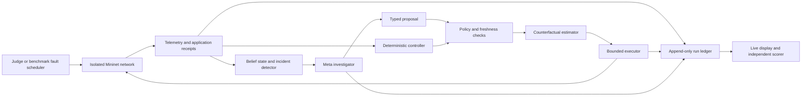

# LIFELINE Emergency Communications Design

**Status:** Planning baseline. Emergency communications was selected by the project owner on October 31, 2026. Implementation and performance qualification have not started.

**Goal:** Preserve timely delivery of essential messages when network failures interact with congestion, incomplete telemetry, and application retries.

**Architecture:** A deterministic network controller maintains a usable operating policy while a Meta model investigates unexpected behavior and proposes bounded changes. Independent validation checks proposed actions; a Linux network emulator executes them; application receipts establish whether service improved. The model never supplies its own success labels.

**Tech stack:** Retain the repository's Node.js ES modules, built-in test runner, and browser interface. Add a Python adapter for Mininet and Open vSwitch in an isolated Linux environment. Use Muse Spark through the existing Meta Responses API approach, with a new typed decision interface. Pin actual dependency versions after the platform qualification run.

**Execution plan:** [Living program](../plans/2026-10-31-lifeline-program.md). **Measurement authority:** [Evaluation protocol](../../research/lifeline-evaluation-protocol.md).

**Storage:** The canonical workspace is `/Volumes/PortableSSD/Meta_Hackathon`. All project-controlled files, caches, environments, outputs, VM disks and snapshots must be stored on the SSD. The reference Linux runtime is a local VM whose native guest filesystem is backed by SSD-resident disk files. Apply the [storage rule and preflight gate](../plans/2026-10-31-lifeline-program.md#0-ssd-workspace-and-storage-rule) before provisioning.

## 1. Product and research objective

The first user is an operator responsible for a temporary emergency communications network. Dispatch, clinic, shelter, and field-team applications exchange synthetic messages over a damaged network. The operator defines which traffic matters and the limits on interventions. LIFELINE identifies developing service loss, investigates plausible causes, and attempts to preserve delivery within those limits.

The first demonstration uses actual processes, packets, queues, and receiver acknowledgements inside a network emulator. Facility names are a comprehensible scenario; there is no connection to a real dispatch center, hospital, radio network, or public infrastructure.

The research question is whether model-guided diagnosis and experimentation add useful recovery capability beyond a competent controller using the same observations, actions, and resources. An application that only explains the deterministic controller's decisions does not answer that question.

The long-term project is a shared investigation and decision layer for critical-service resilience. Communications is the first qualified domain. Water, electricity, and coupled infrastructure each require their own engineering models, actions, validation, and performance evidence.

## 2. Scope decisions

| Decision | V1 choice | Reason |
| --- | --- | --- |
| First domain | Emergency communications | Visible service-level outcomes and controllable failures |
| Execution environment | Mininet on Linux with Open vSwitch | Runs real Linux networking software and applications |
| AI role | Supervisory diagnosis, bounded probing, model updates, intervention proposals | Keeps model latency outside the immediate failover path |
| Immediate response | Shared deterministic failover and policy guard | Every compared adaptive policy receives the same fast response |
| Model representation | Versioned structured network beliefs and explicit uncertainty | Testable without executing model-written code on a privileged host |
| V1 actions | Set a flow route, set a background sender rate, run a bounded path probe, retain current policy | Small enough to validate and compare fairly |
| Learning | Updates from observed outcomes; no model-weight training | Directly tests the proposed decision process |
| Interface | Network map, service delivery, intervention evidence, comparison | The operator can see whether messages arrive |
| Initial hosting | Local browser plus isolated Linux worker | Avoids making hosted operations part of the first experiment |

Mininet creates virtual hosts, switches, controllers, and links, and hosts run standard Linux software. A Linux VM or Linux machine is therefore an explicit dependency for this Mac-based workspace. A graph animation is not an equivalent execution backend. [Mininet overview](https://mininet.org/overview/), [installation options](https://mininet.org/download/).

Three approaches were considered: a synthetic graph simulator, packet-network emulation, and a physical mesh deployment. The simulator remains useful for deterministic contract tests. Packet emulation is the selected first result. A physical deployment follows only after the packet-level behavior and operator workflow are qualified.

## 3. What carries over from Blackbox Apprentice

The repository baseline is commit `d12459829cce71d65771c2a85236d46800bdfe1d`. It identifies one of 36 predefined virtual-device mechanisms, plans within that family, and optionally asks Muse to choose an experiment. That implementation is a reference for observation/action separation and evidence display, not a networking controller.

Reuse the Node server conventions, browser delivery, provider configuration pattern, and explicit predicted-versus-observed presentation. Create separate LIFELINE modules and endpoints. Keep the old device demo runnable while the new vertical slice is qualified.

Do not carry over finite-family identification as a claim of open-ended discovery. Do not reuse the existing session state machine without addressing its observed problems: empty-model verification, experiment-path progress, evidence recorded before execution, omitted failure records, and requests sent after worker exit. Add relevant regression cases to the new boundaries even if the legacy code is left intact.

## 4. Demonstration scenario

Use six transit switches, `r0` through `r5`, connected in a ring, with a direct `r0-r3` link and a `r1-r4` cross-link. Attach dispatch to `r0`, clinic to `r3`, shelter to `r4`, and a field application to `r1`.

Initial development settings are a 20 Mbit/s direct link, 8 Mbit/s ring links, a 6 Mbit/s cross-link, and 5 ms configured link delay. These are synthetic fixture parameters. Measure the attainable rates and actual path delay on the chosen host before freezing the development scenario.

Run three essential UDP message flows with immutable message IDs and acknowledgements, plus two competing background transfers. An initial essential flow emits 80 messages/s with a 1,024-byte payload and a 500 ms deadline. Retry at 250 ms and 400 ms when no acknowledgement arrives; count every transmission, but count each logical message only once for delivery. Acknowledgements are routed and measured too. Background demand is independently scheduled and remains in the offered-load denominator after throttling.

The cascade is causal and measurable: a link outage moves traffic onto a constrained backup; queueing causes missed deadlines; application retries add traffic; another impairment reduces remaining capacity. The UI must display these observations rather than inventing additional failed nodes for dramatic effect.

Use a 120-second evaluation episode with 20 seconds of warm-up, the first incident at 20 seconds, and a second incident at 65 seconds. A live judge may choose from the admitted fault controls; score live exploration separately from the frozen benchmark. The exact rates and timings may change during development, with a recorded protocol revision, before evaluation is frozen.

### Required fault families

| Family | Observable challenge | Required correct behavior |
| --- | --- | --- |
| Link outage | A route stops carrying traffic | Fail over and verify delivery |
| Capacity reduction with link still up | Connectivity checks succeed while deadlines fail | Investigate capacity or congestion; avoid assuming reachability means healthy service |
| Compound outage and traffic surge | Rerouting changes contention | Compare interventions using the new traffic pattern |
| Delayed or missing telemetry | Observations disagree or become old | Preserve uncertainty; obtain fresh evidence or defer |
| Retry amplification | Offered transmissions rise after service loss | Distinguish logical demand from retries |
| Complete partition | No feasible path exists | Report unavailable service; do not claim recovery |

Fault metadata belongs to the experiment orchestrator. The AI receives telemetry and permitted operator inputs, never hidden fault labels, future fault schedules, or actual impaired capacity from the administrative backend.

## 5. Architecture and authority



| Component | Owns | Must not own |
| --- | --- | --- |
| Experiment orchestrator | Scenario construction, fault injection, workload schedule | Controller decisions or scored success labels |
| Telemetry collector | Measurements with sequence, age, source, units | Hidden administrative truth in controller observations |
| Service policy | Priorities, deadlines, allowed controls, budgets | Model-generated changes to the objective |
| Belief updater | Capacity intervals, suspected faults, evidence references | Replacement of measured history |
| Meta investigator | Diagnostic hypotheses, probes, proposed interventions | Shell access, direct worker access, success certification |
| Counterfactual estimator | Predicted consequences and model assumptions | Claiming predicted delivery was observed |
| Admission guard | Schema, freshness, authority, route and budget constraints | Guaranteeing end-to-end delivery from a forecast |
| Executor | Apply, acknowledge, verify, compensate, report partial effects | Silently treating a partial command as atomic success |
| Receipt scorer | Recompute delivery from sender and receiver events | Trusting narrative claims or dashboard counters |

Run the supervisor outside the privileged network worker. The worker accepts allowlisted typed commands over a private local transport. Network object names come from a registry; model text is never interpolated into shell commands. This boundary is needed because the chosen emulator manipulates network namespaces and switch rules.

For the reference deployment, run the Node supervisor, Python worker, and packet applications on the same isolated Linux machine; use the Mac as a browser client through a forwarded local endpoint. Use a run-owned Unix-domain socket for worker commands. Keep packet timestamps on the Linux monotonic clock, and establish a shared run epoch during the handshake for supervisor event correlation. Do not compare raw Mac and Linux monotonic timestamps. A distributed worker is a later adapter with an explicit clock-error contract.

## 6. Observation and action contracts

All messages carry a version, run ID, sequence, and monotonic timestamp in milliseconds. Fields with physical quantities name their units. Reject unknown fields at authority boundaries, invalid IDs, nonfinite values, negative durations, oversized collections, and incompatible schema versions.

| Record | Required contents |
| --- | --- |
| `ObservationV1` | Run ID, sequence, sample interval, collection time, known topology revision, per-link counters and sample age, per-service offered/received/deadline counts, current configuration revision |
| `ServicePolicyV1` | Essential flow IDs, immutable deadlines and priorities, allowed nodes and actions, background-rate bounds, intervention and probe budgets |
| `BeliefV1` | Revision, evidence event IDs, capacity intervals, competing explanations, unsupported assumptions, age and contradiction state |
| `ProposalV1` | Proposal ID, run ID, base configuration revision, observation sequence, expiry, policy identity, explicit preconditions, ordered typed actions, predicted consequences and cited evidence |
| `DecisionV1` | Proposal ID, admission result, stable reason code, guard checks, forecast identity, current configuration revision |
| `ActionReceiptV1` | Operation ID, actual start/end, attempted and confirmed effects, resulting configuration revision, observation references, compensation outcome |
| `RunManifestV1` | Code/runtime identities, policy and workload identities, scenario commitment, controller/model/prompt configuration, budgets, timestamps, terminal status |

The first action union is:

```text
set_route(flow_id, path_node_ids)
set_background_rate(source_id, bits_per_second)
probe_path(source_id, destination_id, packet_count, payload_bytes, interval_ms[, path_node_ids])
retain_policy(reason_code)
```

A route must be a simple path in the observed topology, have the correct endpoints, and use registered nodes. A probe may name the registered path it tests (D11, October 31); probe and echo are pinned to that path, and without one the worker uses a deterministic shortest path. A flow route includes a separate acknowledgement path. Only background senders may be throttled. A probe has fixed packet and byte ceilings. No action alters essential source demand, message deadlines, service classification, fault schedules, or scoring.

Bind a proposal to the configuration revision, policy identity, and observed evidence. A normal telemetry sample does not itself invalidate every in-flight proposal. Before execution, recheck the configuration revision, proposal expiry, and its explicitly declared telemetry preconditions against a fresh observation. A changed route, failed precondition, or stale observation rejects the proposal.

Initial proposed limits are a 10-second proposal lifetime from its initiating observation and a 2-second maximum age for the fresh observation used at admission. Preserve the originating observation as evidence while using the newer observation for precondition checks. Freeze these limits with the measured provider timing in the policy fixture; they are not inferred from the model's response.

### Stable outcomes

```text
proposal_invalid
policy_mismatch
configuration_stale
observation_stale
precondition_failed
route_unavailable
budget_exhausted
model_inconsistent
forecast_unavailable
provider_unavailable
provider_timeout
action_rejected
action_partial
worker_unavailable
verification_failed
service_unavailable
run_incomplete
```

An empty set of plausible explanations is `model_inconsistent`, never verified success. An unavailable forecast cannot become an AI intervention merely because the model expresses confidence. The deterministic controller remains separately identifiable when it takes over.

## 7. Timing and control behavior

Immediate link-status handling belongs to the deterministic controller. The AI investigates at incident boundaries and persistent prediction errors, not once per packet. The network continues running during API calls; clocks never pause to improve AI results.

Initial development budgets are one outstanding proposal, at most two model calls per incident decision, a 10-second decision deadline, a 6-second individual API timeout bounded by the remaining deadline, and 1,500 output tokens per call. A run permits at most 12 model calls and 12 executed intervention bundles. Probe traffic is capped at 64 KiB per probe and 256 KiB per incident. Every attempt, rejection, retry, and timed-out call consumes its applicable budget.

These are proposed operating limits, not measured capabilities. Gate 0 records actual model latency, credits, and packet timing. If useful model decisions cannot arrive in time, the model remains a slower advisory component and the performance claim changes accordingly.

State progression is `observing -> investigating -> proposed -> evaluating -> executing -> verifying -> observing`. Any stage can produce a recorded rejection or interruption. `degraded` means the deterministic controller is operating after AI failure. `unavailable` means the required service cannot currently be delivered. Neither is displayed as a successful AI recovery.

## 8. Beliefs, prediction, and experimentation

The V1 model knows networking primitives and the registered topology. It estimates changing effective capacity and contention; it does not rediscover Internet protocols. Keep intervals rather than invented precise probabilities. Every hypothesis cites observations that support it and an experiment that could contradict it.

Use a deterministic capacity-and-flow estimator for counterfactual ranking. It evaluates route/rate combinations under the current capacity intervals and records assumptions. It must be tested against hand-calculated examples, then calibrated against packet runs. The Mininet truth backend is not available as a free oracle for counterfactuals.

A probe trades information against network load and time. All controllers can call the same probe operation within the same limits. Probe outcomes enter ordinary telemetry and evidence. Do not grant the AI measurements that the strong conventional baseline cannot obtain.

A hypothesis may be invalidated by new measurements. Retain the old version and its contradiction, update the belief, and invalidate dependent proposals. Forecast agreement over prior observations is an empirical consistency check, not a guarantee for future failures.

Schema already constructs executable environment models, checks them against interaction history, plans inside them, and verifies execution. V1 borrows that discipline but uses a bounded structured model. It does not claim to invent the loop or reproduce Schema's full program-induction capability. [Schema paper](https://arxiv.org/html/2609.39140v1).

## 9. Applying actions and recovering from interruption

Network changes are not globally atomic. For route changes, prepare rules for a new path version, check acknowledgements, change the ingress classifier, verify receipt traffic, and retire the old version after the declared drain interval. Use version tags and explicit acknowledgement paths; qualify the tag and rule lifecycle before enabling route changes in the demo.

For rate changes, retain the prior value, apply the new value, read back the effective setting, and verify traffic observations. A bundle is a sequence of individually acknowledged operations. Budget and capacity checks include transition states, not only the final configuration.

If a step fails, record which effects occurred. Revert a still-feasible old configuration, or let the deterministic controller establish a new feasible policy. A failed link can make literal rollback impossible. In that case, report the compensated configuration and actual service condition instead of claiming the old state was restored.

After worker exit, reject pending and future requests until a new worker completes its handshake. Prevent duplicate effects with operation IDs and recorded receipts. Cancellation stops new actions; any already-started action must finish or be reconciled. Restart requires read-back before resuming control.

## 10. Evidence and interface

The primary outcome is the fraction of scheduled essential logical messages received within their declared deadlines. Score it from immutable offered-message records and receiver receipts. Include loss, lateness, duplicates, retries, action overhead, and time spent waiting for the model.

The main screen has a network map, one service strip per endpoint, a visible fault control, an intervention timeline, and a comparison panel. Show actual delivery on time, missed deadlines, recovery state, and background throughput. Expose a short evidence-backed explanation when an intervention occurs. Do not show fabricated internal reasoning.

Every panel identifies its run and mode: `live-meta`, `live-deterministic`, `recorded-replay`, or `contract-test`. If an API call fails and deterministic control continues, display that transition. A replay is a useful fallback presentation but must remain visibly labeled.

For a live side-by-side view, use two isolated network instances only after CPU contention and workload isolation have been measured. Otherwise show the current run beside a labeled retained comparator using the same scenario. Formal evaluation uses repeated paired runs and randomized execution order; it does not assume identical packet schedules across operating-system runs.

## 11. Success boundaries

The first usable increment is a reproducible packet-network experiment with trusted metrics and a competent baseline. The next increment adds bounded AI intervention and a measured comparison. A visible recovery is useful demo evidence; a research claim requires the frozen evaluation protocol.

The target contribution is improved essential-service preservation under the declared compound failures and observation limits. If a conventional controller matches or beats the AI, retain that result and investigate the mechanism. Do not weaken the comparator or relabel a forecast as measured improvement.

Open-ended generated programs, physical radios, real emergency traffic, autonomous infrastructure control, and transfer to new infrastructure domains are separate later capabilities. Each enters through a new design decision and its own acceptance evidence.

## 12. Decisions that can change the implementation

| ID | Decision | Current disposition | Revisit trigger |
| --- | --- | --- | --- |
| D01 | First domain | Emergency communications, confirmed by owner | New explicit project direction |
| D02 | Packet backend | Mininet/OVS on Linux | Gate 0 cannot obtain a working isolated host |
| D03 | Agent model | Muse Spark through Meta API | Access, latency, or cost measurement fails |
| D04 | AI authority | Typed proposals through guard and executor | No silent widening; requires a new contract |
| D05 | Representation | Structured beliefs in V1 | Research phase qualifies sandboxed executable models |
| D06 | Primary outcome | Deadline delivery over fixed offered demand | A new protocol version before evaluation |
| D07 | First release | Local research demo | A separately qualified hosting or pilot release |
| D08 | Broader domains | Separate adapters after communications evidence | Domain-specific qualification passes |

Update the living program and run register when one of these changes. Preserve old results under their original protocol and configuration identities.
