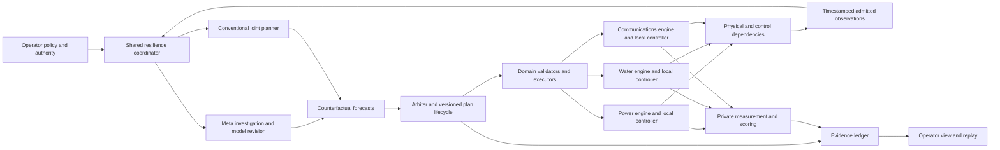

# LIFELINE Infrastructure Resilience Design

**Status:** Planned full-program design, November 1, 2026. The implemented communications prototype remains described by the [V1 design](2026-10-31-lifeline-design.md). This document does not describe capabilities already present in code.

**Program:** [Living master](../plans/2026-10-31-lifeline-program.md). **Evidence:** [Run register](../../trials/lifeline-run-register.md). **Measurement:** [Infrastructure evaluation](../../research/lifeline-infrastructure-evaluation.md).

## 1. System boundary and users

LIFELINE helps infrastructure operators anticipate threats, compare interventions, preserve essential services, and restore them. The initial operator controls a synthetic town in a qualified simulator. Later users are utility operators, incident coordinators, and facility operators with different information and authority.

A service has an explicit consumer, offered demand, minimum usable quality, deadline or continuity requirement, priority, reserves, and dependencies. A facility's water, electricity, and communications remain separate measured services even when a higher-level operational service requires all three.

The coordinator receives admitted observations, declared asset information, operator policy, and approved model knowledge. It cannot read the evaluator's hidden faults, future incident schedule, ground-truth impairment parameters, or private scoring state. The model proposes evidence-linked hypotheses, probes, and plans. Domain validators and actual outcomes remain authoritative.

## 2. Architecture

The coordinator shares observation admission, service objectives, hypothesis bookkeeping, candidate scheduling, authority, evidence, and evaluation plumbing. Each domain owns state estimation details, equations, control vocabulary, response timing, equipment limits, and independent checks. A shared lifecycle is not a claim of identical physics.

Fast local controllers remain enabled in every AI mode. A provider failure reduces supervisory capability; it must not remove protection or baseline recovery. The solver/model workload cannot occupy the local controller's event loop or an unbounded shared lock.

## 3. Proposed source layout

These are planned files, not existing modules.

| Path | Responsibility |
| --- | --- |
| `src/lifeline/kernel/contracts.mjs` | Strict versioned envelopes, quantities, capabilities, identities |
| `src/lifeline/kernel/clock.mjs` | Wall/monotonic/simulation time mapping and deadlines |
| `src/lifeline/kernel/arbiter.mjs` | Priorities, conflicts, stale plans, bounded execution slots |
| `src/lifeline/kernel/coordinator.mjs` | Observe/forecast/compare/act/verify lifecycle |
| `src/lifeline/kernel/services.mjs` | Service requirements and dependency graph |
| `src/lifeline/kernel/forecast.mjs` | Forecast records, uncertainty, validity and calibration |
| `src/lifeline/kernel/plans.mjs` | Action DAGs, preconditions, transitions and effect contracts |
| `src/lifeline/kernel/model-store.mjs` | Versioned hypotheses/models, evidence and retirement |
| `src/lifeline/kernel/measurement.mjs` | Independent service accounting; no controller imports |
| `src/lifeline/domains/communications.mjs` | Wrap existing network lifecycle without changing V1 artifacts |
| `src/lifeline/domains/power.mjs`, `water.mjs` | Typed adapters to qualified Python workers |
| `src/lifeline/controllers/joint.mjs`, `meta-joint.mjs` | Conventional joint planning and Meta-assisted supervision |
| `runtime/infra/` | Python protocol, domain engines, coupling, private scoring and solver baselines |
| `scripts/lifeline-infra-run.mjs`, `lifeline-infra-evaluate.mjs`, `lifeline-infra-replay.mjs` | New infrastructure experiment entry points |
| `fixtures/lifeline/infra/` | Versioned public manifests, analytic controls, policies and development cases |
| `test/lifeline/infra/`, `runtime/infra/tests/` | Behavioral and numerical qualification |
| `artifacts/lifeline/infra/` | Retained runs, manifests, receipts, traces, forecasts and comparisons |

Keep `scripts/lifeline-run.mjs` and the existing network contract available for V1 replay. There is no current `src/lifeline/runner.mjs`; do not plan edits against an invented existing file.

## 4. Common contract

All messages include `schemaVersion`, `runId`, `domainId`, `sequence`, and `tickUs`. Simulation time is a nonnegative integer number of microseconds since episode start. Physical quantities carry a value and a canonical unit; input conversions are explicit. Missing values are `null` with a reason, never zero.

### Objects

| Object | Required fields beyond the envelope |
| --- | --- |
| Observation | `observationId`, `assetId`, `metric`, `quantity`, `observedAtUs`, `receivedAtUs`, `quality`, `sourceId`, `configurationRevision` |
| Service contract | `serviceId`, consumer, quantity/quality/deadline, immutable demand schedule reference, priority tier, reserve model, service equation version |
| Capability | Action type, typed parameters and units, affected assets, allowed authority modes, limits, expected duration, reversibility and effect checks |
| Hypothesis | ID, statement, supporting/contradicting observation IDs, parameter intervals, alternative explanations, discriminating test, expiry |
| Forecast | ID, origin observation set/hash, configuration/model versions, horizon, service outcomes/intervals, assumptions, support status |
| Plan | `planId`, proposer, source observation set/hash, expected configuration revisions, model/policy versions, expiry, action DAG, budgets, forecasts, rationale references |
| Action | ID, domain/capability, typed parameters, preconditions, effect deadline, lock set, authority grant, compensation/stop behavior |
| Receipt | Action/run IDs, requested/started/completed times, actual settings, observed effects, success/partial/rejected/unknown status and reason |
| Measurement | Immutable workload reference, independent observed supply/quality, interval, missing-data status, evaluator provenance |

Reject unknown action fields, NaN/infinity, invalid units, duplicated IDs with conflicting content, out-of-order revisions, cross-run references, unsigned authority grants where required, and expired plans. A model's confidence string is not a probability calibration.

A plan is bound to the evidence and configuration on which it was based. If state changes before execution, it is revalidated or rejected. The executor must not silently re-stamp an old suggestion as fresh.

### Adapter interface

Define `describe()`, `initialize(manifest)`, `observe(request)`, `preview(plan, modelSnapshot)`, `validate(action, context)`, `execute(action, context)`, `readback(actionId)`, `checkpoint()`, `restore(checkpoint)`, `advance(toTickUs, inputs)`, and `close()`.

Not every adapter supports every operation. `describe()` reports supported operations and exact limitations. Missing checkpoint/fork capability disqualifies that adapter from experiments requiring counterfactual branching until an equivalent qualified restart method exists.

`preview` forks an admitted estimated model, not the evaluator's hidden true plant. Actual evaluation rollouts may fork private ground truth in a separate process, inaccessible to controllers. This separation prevents perfect counterfactual knowledge from leaking into decisions.

## 5. Domain profiles

| Domain | State and observations | Initial admitted actions | Hard boundary and score |
| --- | --- | --- | --- |
| Communications | Link/counter ages, paths, queue/loss evidence, independent destination receipts | Existing `set_route`, `set_background_rate`, `probe_path`, `retain_policy` | Loop-free allowed routes, probe/rate bounds, transition costs; fixed-denominator deadline delivery |
| Power | Topology, available generation, voltage, loading, demand, storage state with age/uncertainty | Qualified switch/reconfiguration choices, bounded redispatch or demand shifts, storage commands if modeled | AC feasibility, thermal/voltage/equipment limits, ramps/interlocks; unserved essential energy and outage duration |
| Water distribution | Pressure, flow, tank volume, pump/valve states, demand and observation quality | Pump schedule within qualified states, allowed valve settings, pressure/demand policies | Pressure/storage/pump/valve limits, mass balance; delivered demand at declared quality and service deficit |
| Water treatment | Qualified process sensors, unit state, residence/buffer state, influent uncertainty | Advisory process adjustments; later site-approved setpoints or unit isolation | Process-specific constraints and validated quality model; compliant output, not hydraulic volume alone |
| Transport/repair | Road access, travel time, crew skills/location, parts, task precedence | Crew assignment, feasible routes and repair sequence | No teleportation, travel/work duration, shift/resource constraints; restoration time and service deficit |
| Facility systems | Backup energy, water reserves, HVAC or cooling state, dependent service requirements | Qualified demand scheduling, reserve allocation, approved equipment modes | Facility-specific operating envelope; time meeting the declared service requirement |

Use pandapower's electrical calculations for the first coupled town; Grid2Op is a separate operations benchmark path. Steady-state feasibility does not establish transient stability, protection coordination, black start, or safe physical switching. Such claims require a separately qualified model and experiment. [pandapower documentation](https://pandapower.readthedocs.io/en/latest/), [Grid2Op documentation](https://grid2op.readthedocs.io/en/latest/).

Use pressure-dependent distribution hydraulics for shortage experiments. WNTR is a distribution tool; its hydraulic engine is not a treatment-plant chemistry model. Qualify the selected backend's restart, hydraulic and quality capabilities individually. [WNTR overview](https://usepa.github.io/WNTR/), [hydraulic engines](https://usepa.github.io/WNTR/hydraulics.html).

## 6. Coupling equations and causal structure

A dependency edge records source, destination, mechanism, units, delay, capacity/threshold, uncertainty, evidence, and fallback. An edge can mean physical supply, control/telemetry dependence, shared resource, or common hazard; these must not be conflated.

Initial physically interpretable couplings:

- **Electricity → pumps:** electrical availability and qualified operating state determine whether the pump can deliver its hydraulic curve. Model start delay and permitted states. Hydraulic load feeds back into electrical demand.
- **Pump demand → electricity:** use the qualified pump power relation, e.g. `P = rho * g * Q * head / efficiency`, with the correct signs and validity range. Do not generate power from a negative-flow artifact or extrapolate an invalid efficiency.
- **Tank reserve → water service:** `V_next = V + (inflow - outflow) * dt`, bounded by usable storage. Flow and pressure remain governed by the hydraulic solver.
- **Electricity → communications:** equipment continues only while supplied power or modeled battery reserve is adequate. Account for finite energy and restart delay.
- **Communications → remote operation:** delayed/lost messages delay or prevent command acknowledgements and telemetry. Local protection continues. A dropped packet does not instantly destroy a water pipe or trip a feeder unless a qualified local policy produces that effect.
- **Shared backup/repair capacity:** fuel, generators, crews and parts have conservation and exclusivity rules. The same portable resource cannot be allocated twice.

Independent tests remove or reverse each declared dependency, increase reserves, and alter delays. Downstream failures must change for the predicted reason. Common-cause storms can fail multiple assets directly; do not label every simultaneous failure a propagated cascade.

Solve mutually dependent states using a documented bounded iteration with convergence tolerances or a qualified staggered scheme. Test sensitivity to step size and iteration order. Nonconvergence is explicit; it never yields a successful green status. Distinguish physical infeasibility from numerical failure using the frozen evaluator rules.

## 7. Time and execution

Track separate monotonic controller time, simulator time, observation time, command time, and presentation time. Declare the mapping in the run manifest.

- **Real-time hybrid mode:** simulation and wall time advance at 1:1 while actual packet traffic runs. Electrical/hydraulic steps use a qualified cadence; hours of water reserve require a correspondingly long run or a clearly chosen smaller physical system.
- **Accelerated simulation mode:** use a modeled communications adapter calibrated against packet runs; label it as modeled. Apply declared acceleration consistently and charge measured inference/solver time to the simulation clock. A 15-second call at 60× consumes 15 simulated minutes.
- **Replay:** playback speed changes presentation only; it does not change original deadlines, outcomes, or controller cost.

No model call freezes the plant. State continues to evolve and local control continues. Deadlines use time at completion, not the request snapshot. Proposal age includes observation delay, reasoning, solver work, queueing and command execution. Cancel or expire obsolete work.

Test hybrid step alignment, lost telemetry, clock jumps, restart, and end-of-run deadline tails. Wall-clock network emulation is not perfectly deterministic; retain raw observations and do not require bit-identical packet traces.

## 8. Decisions, authority and action transitions

Authority modes are `observe`, `recommend`, `approve_each`, and `bounded_auto`. Each grant names the domain, assets, action types, numeric limits, time window, and approving identity. Simulation grants are distinct from lab or site grants.

Priority is: local protection; current essential-service recovery within policy; admitted supervisory improvement; diagnostics; discretionary work. Priority does not make conflicting physical actions safe. The arbiter checks dependencies, lock sets, versions, dwell times, resource budgets, and emergency cancellation points.

A multi-domain plan is a directed acyclic graph of actions and effect checks. Do not assume a distributed atomic transaction. Stages may partially succeed. Observe actual state, revise the remaining plan, and choose a qualified compensation or stop action. Restoration can be safer than rolling back; some actions are irreversible. Never claim rollback restored a physical system without readback.

The guard checks syntax, authority, current state, engineering constraints, predicted transition states, and allowed uncertainty. A passing forecast is not a formal safety proof. Unexpected effects trigger a recorded interruption, continued local control, and re-assessment.

## 9. Meta's role and model improvement

The investigator receives a compact evidence packet and typed capability catalog. It returns hypotheses, discriminating observations/probes, candidate plan templates, expected effects, and what would falsify its reasoning. It may identify a missing dependency or incorrect parameter, but cannot edit trusted solvers, policy, scoring, or authority.

Counterfactual search evaluates model and conventional candidates through the same models and budgets. Every chosen plan cites an evidence path, expected service benefit, intervention cost, and unresolved risk. A useful choice may be to retain policy or ask an operator for a missing observation.

Begin with structured model revisions. Escalate to executable model induction only when a documented failure requires a new state variable or transition mechanism. Generated code runs in a resource-limited sandbox with no credentials, host network, hidden benchmark data, or privileged worker access. Backtest before use, test forward on unseen transitions, and retire contradicted models. Learned models never replace authoritative equipment constraints.

Before an investigation, estimate the time still available for a useful action: the conservative predicted service-loss time minus current time, actuation duration and an explicit uncertainty margin. This determines an investigation's maximum useful deadline, subject to the stricter configured resource cap. Recompute it when evidence changes; already available protective actions do not wait for reasoning.

Choose information-gathering actions by their expected effect on the decision, including time, service disruption and probe cost. If information is unlikely to change the admitted plan before its opportunity expires, retain the current plan or execute the best qualified alternative. These estimates require calibration; uncertain timing is not a guarantee. P19 compares this scheduling policy with fixed-cadence investigation to test whether it actually improves outcomes.

No weight fine-tuning is required for the initial program. The research question is useful adaptation and coordination, not a claim that persistent models or program induction are new.

## 10. Threat inputs beyond fault injection

Admit telemetry, equipment alarms, maintenance/configuration history, operator incident reports, and externally supplied hazard forecasts through the same provenance and time boundary. A weather forecast or image-derived damage observation is uncertain evidence, not the evaluator's future event schedule. Record source, issue time, location/asset association, confidence calibration, licensing and missingness.

Multimodal interpretation can add value when an actual task requires images, maps or documents; it must produce testable observations with cited evidence. Compare it against the same information available through conventional extraction or operator input. Do not add a model modality solely to increase the number of Meta products in the demo.

## 11. Product and operational behavior

The interface shows services first, then physical dependencies, uncertainty, forecasts, action alternatives and receipts. It displays which controller proposed each action and which checks admitted or rejected it. Distinguish predicted loss from measured loss, unavailable from zero, and live from replay. Facility labels are synthetic until a qualified site integration exists.

Operator controls include inject an admitted simulation fault, approve/cancel within authority, pause presentation, stop a run, inspect evidence, and export. Pausing presentation must not pause a scored plant. A stopped or incomplete experiment retains its evidence and cannot be silently scored as complete.

Later site integration uses read-only telemetry first, then recommendation and approval workflows. Define the site owner, maintenance window, incident escalation, audit retention, credential boundary, and local override before any live actuation. These are deployment acceptance conditions, not extra permissions required to write or implement the simulator plan.

## 12. Reproducibility and acceptance

Each bundle records code and dirty-tree identity, protocol/scenario/solver versions, input hashes, seed, policy, authority, clocks, workload, observed events, requests/responses with secrets removed, action receipts, forecasts, metrics, resource use, and all attempts. Private evaluator truth is stored separately and exposed only after the relevant split is retired.

A replay verifies identities and reconstructs scores from independent measurements. It must not ask the model to grade its own actions. A clean environment must rebuild a minimal town from pinned inputs; recorded API responses may replay provider contracts, but live-provider qualification requires separate live evidence.

Every claimed domain lists supported assets, actions, fault mechanisms, observability, timescales, model validity, and known exclusions. The complete program is a growing set of qualified envelopes, not a promise to control arbitrary infrastructure.
